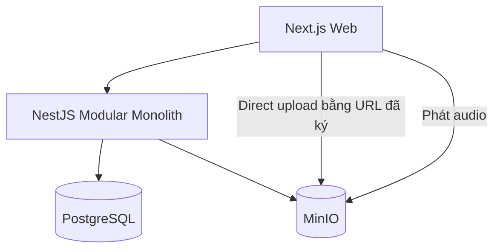
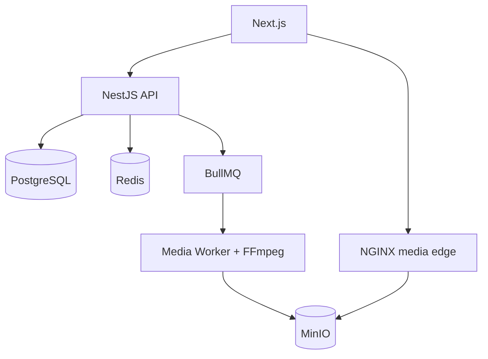
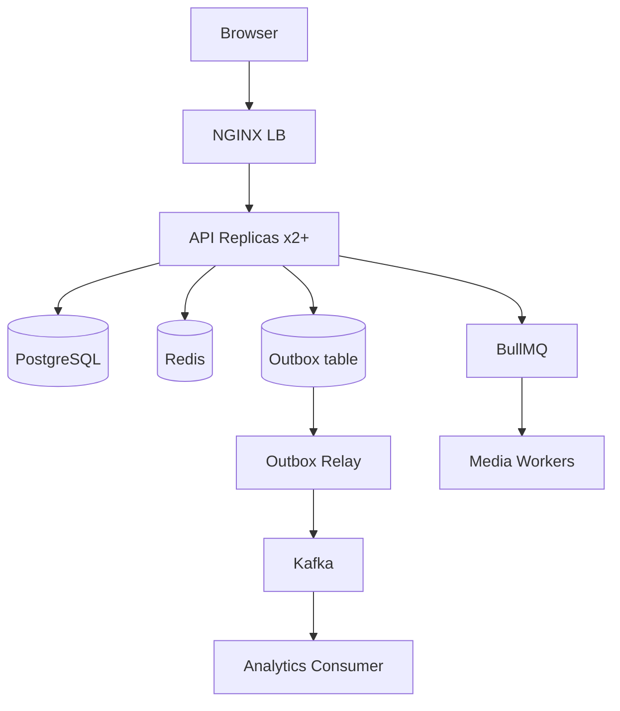

# STREAMFLOW — ADVANCED BACKEND & DISTRIBUTED SYSTEMS ROADMAP

**Lộ trình 24 tuần | TypeScript end-to-end | Phiên bản 1.0 — 31/10/2026**

> Mục tiêu: xây một nền tảng nghe nhạc/xem phim theo kiểu Video on Demand (VOD) và dùng chính sản phẩm này làm phòng thí nghiệm cho Backend Engineering, Distributed Systems, Performance, Infrastructure và Reliability Engineering.

## 0. Cách sử dụng roadmap

- **Thời lượng giả định:** 12–18 giờ/tuần, tổng 288–432 giờ. Đây là ước tính, không phải cam kết thời hạn.
- **Mỗi milestone = 2 tuần:** tuần đầu học, thiết kế và xây; tuần thứ hai hoàn thiện, kiểm thử, benchmark, viết kết luận.
- **Mỗi milestone phải có:** một tính năng chạy được, một bài đo có số liệu, ít nhất một failure experiment, một ADR (Architecture Decision Record), và một demo ngắn.
- **Không thêm công nghệ chỉ để tick checklist.** Trước mỗi bước nâng cấp, ghi nhận bottleneck hoặc vấn đề tin cậy cần giải quyết.
- **Mục tiêu không phải xây Netflix thật.** Không triển khai live streaming, thanh toán, DRM, recommendation bằng ML, multi-region production trong phiên bản chính.
- **Bản quyền:** chỉ sử dụng video/nhạc tự tạo, được cấp phép hoặc thuộc public domain; không xây chức năng lấy lậu nội dung từ nền tảng khác.

### Tiêu chí tốt nghiệp sau 24 tuần

1. Có web nghe nhạc, xem phim, upload và xử lý media thực sự hoạt động.
2. Có thể triển khai API thành **ít nhất hai replicas**, chứng minh load balancing và kiểm tra lỗi một instance.
3. Xử lý media bất đồng bộ, có retry, idempotency, trạng thái lỗi, DLQ hoặc quarantine tương đương.
4. Chứng minh được một workflow DB + event có chống mất event bằng transactional outbox.
5. Có k6 benchmark trước/sau tối ưu, ghi p50/p95/p99, throughput, error rate, CPU/RAM, DB queries.
6. Có metrics, logs, distributed tracing và ít nhất ba failure experiment có postmortem.
7. Deploy được bản staging có DNS, HTTPS, CI/CD; có Kubernetes lab với HPA và rolling update.
8. Có tài liệu kiến trúc, sơ đồ triển khai, ADR, runbook, capacity/cost analysis và demo cuối.

---

## 1. Phạm vi sản phẩm và nguyên tắc kỹ thuật

### 1.1 Tính năng đủ dùng

**User:** đăng ký/đăng nhập; duyệt và tìm media; nghe nhạc/phát phim; resume; favorites; playlists; lịch sử xem/nghe; profile.

**Admin:** tạo metadata; nhận upload video/audio; xem tiến trình xử lý; retry job lỗi; publish/unpublish nội dung; xem dashboard kỹ thuật.

**Streaming:** audio bằng HTTP Range ở giai đoạn đầu; video VOD bằng HLS có nhiều rendition; playback access bằng URL có thời hạn hoặc cơ chế edge authorization; media delivery không đi xuyên qua luồng JSON API thông thường.

**Vận hành:** logs, metrics, traces, health checks, alerts; deploy và rollback; failure testing.

### 1.2 Những thứ chủ động để sau

- Recommendation ML, social features, chat, subtitles đa ngôn ngữ tự động.
- Live streaming, WebRTC, DRM/EME ở quy mô thương mại, hệ thống subscription và payment.
- Database sharding, multi-region active-active, service mesh, Kafka cluster nhiều broker trên VPS nhỏ.
- Native mobile app: Next.js web responsive/PWA là đủ cho 24 tuần.

### 1.3 Nguyên tắc kiến trúc

1. **Modular Monolith trước:** tổ chức module và contract sạch, chưa tách microservices.
2. **Control plane khác data plane:** NestJS quản lý metadata/quyền; object storage/CDN truyền byte media.
3. **Scale theo bottleneck:** API replicas, transcoding workers, DB, storage và edge có cơ chế scale khác nhau.
4. **Reliability trước glamour:** timeout, backpressure, bounded retries, idempotency, graceful shutdown.
5. **Đo trước rồi tối ưu:** không dùng caching, Kafka, Kubernetes như bằng chứng tự thân về hiệu năng.

---

## 2. Technology stack đề xuất

| Nhóm | Công nghệ chốt | Vì sao và kiến thức sẽ học |
|---|---|---|
| Frontend | Next.js + TypeScript + hls.js | UI, routing, media player, HTTP network inspection |
| API | NestJS + Fastify adapter | Module, DI, request lifecycle, validation, guards, interceptors |
| Validation/contracts | Zod, OpenAPI | Runtime validation, schema compatibility, SDK contracts |
| Monorepo | pnpm workspaces; Turborepo nếu cần | Shared contracts, build graph; không phức tạp hóa ngay |
| Database | PostgreSQL + Drizzle ORM + SQL trực tiếp | MVCC, index, EXPLAIN, transaction, lock, pool |
| Cache | Redis | Cache-aside, TTL, invalidation, stampede, rate limiting |
| Queue 1 | BullMQ | Retry/backoff, concurrency, delayed jobs, job lifecycle |
| Broker 2 | Kafka (KafkaJS) | Partition, offset, ordering, consumer group, at-least-once |
| Object storage | MinIO local → S3-compatible/cloud | Direct upload, multipart, object lifecycle, signed URLs |
| Media processing | FFmpeg trong worker container | Transcoding, segmentation, bitrate, codec, CPU capacity |
| Edge | NGINX, tùy chọn CDN | Reverse proxy, round robin, caching, TLS, routing |
| Containers | Docker/Compose | Network, volumes, env, healthcheck, resource limits |
| Orchestration | kind/k3d local → k3s hoặc managed Kubernetes (tùy ngân sách) | Deployments, Services, Ingress, resources, HPA |
| IaC | Terraform (stretch), Helm/Kustomize | Reproducibility, drift, rollback |
| Observability | OpenTelemetry + Prometheus + Grafana + Loki/Tempo | Metrics, logs, traces, alerting, correlation |
| Testing | Vitest, Supertest, Testcontainers, Playwright, k6 | Unit/integration/E2E/load/fault tests |
| CI/CD | GitHub Actions | Lint, test, image build, migration gates, deploy |

**Vì sao chọn Drizzle/SQL:** mục tiêu hiểu bản chất SQL; phải biết inspect query sinh ra, transaction scope, index và lock. Nếu đã quen Prisma, có thể giữ Prisma nhưng vẫn thực hiện các bài EXPLAIN/SQL thủ công.

**BullMQ và Kafka không thay thế 1:1:** BullMQ phù hợp background jobs có lifecycle; Kafka phù hợp stream sự kiện có nhiều subscriber và khả năng replay. Ban đầu dùng BullMQ, sau đó thêm Kafka cho analytics và event fan-out; chỉ chuyển transcode scheduling nếu có mục đích rõ ràng.

---

## 3. Kiến trúc qua bốn cấp độ

### Level 1 — Tuần 1–8: Modular monolith



Backend một process, một DB. API không proxy file upload lớn. Dữ liệu quản lý trong PostgreSQL, binary media trong object storage.

### Level 2 — Tuần 9–14: Async media + performance



Worker tiêu thụ job theo giới hạn CPU/RAM. API trả về sớm, UI polling trạng thái xử lý. Nhiều rendition video được lưu dưới namespace object ổn định.

### Level 3 — Tuần 15–20: Distributed runtime



API stateless; mọi replica nhìn cùng dữ liệu; JWT/cookie không phụ thuộc memory từng replica. Redis, DB và NGINX đơn lẻ vẫn là SPOF trong lab — phải ghi rõ, không tuyên bố toàn hệ thống HA.

### Level 4 — Tuần 21–24: Cloud-native lab

Kubernetes quản lý các API pods, worker pods và Ingress; stateful dependencies nên dùng managed services hoặc đặt ngoài cluster trong môi trường staging nhỏ để giảm gánh nặng vận hành. HPA cho API dựa CPU trước, thử worker autoscaling dựa queue depth ở bài nâng cao. Dùng tracing/metrics để quan sát scaling, rollout và lỗi.

### Hai luồng cốt lõi

**Upload/publish**

1. Admin gọi `POST /admin/uploads/init` với tên file, kích thước dự kiến, MIME và metadata.
2. API authz, kiểm tra quota, sinh random object key và URL upload có hạn, ghi `upload_session`.
3. Client upload thẳng vào object storage, với multipart cho file lớn.
4. Client gọi `POST /admin/uploads/:id/complete`.
5. API kiểm tra object thực sự tồn tại, size/checksum, quyền sở hữu, metadata an toàn; cập nhật DB.
6. Hệ thống enqueue transcode bằng BullMQ; worker xử lý job có khóa idempotency.
7. Worker tạo thumbnail, HLS master/variant playlists và segments; kiểm tra output, upload toàn bộ artifact.
8. Đổi trạng thái `READY` chỉ sau khi output hợp lệ, rồi admin `publish`.

**Playback**

1. User gọi `GET /media/:id` → metadata từ API/cache.
2. User gọi `POST /playback/:mediaId/start` → authorization, playback session + manifest URL được phép truy cập.
3. Player lấy `.m3u8` và `.ts`/`.m4s` trực tiếp qua edge/object store, không đi qua Node API process.
4. Player gửi progress định kỳ hoặc khi pause/seek/end, có session ID và sequence để chống event cũ ghi đè event mới.
5. API ghi resume có debounce/batching nếu cần; phát `playback.started/completed` event để analytics xử lý bất đồng bộ.

**Lưu ý signed URL:** HLS có nhiều playlist/segment. Không thể chỉ ký URL master playlist rồi mặc nhiên các segment riêng tư cũng an toàn. Giai đoạn đầu có thể dùng media public hợp pháp trong lab; giai đoạn bảo mật cần edge signed cookies/token hoặc cơ chế ký/authorize phù hợp toàn bộ đường dẫn segment.

---

## 4. Repository và module boundaries

```text
streamflow/
├── apps/
│   ├── web/                  # Next.js + player + admin
│   ├── api/                  # NestJS modular monolith
│   ├── media-worker/         # FFmpeg, thumbnail, HLS
│   ├── event-relay/          # Outbox -> Kafka
│   └── analytics-consumer/   # Event projections
├── packages/
│   ├── contracts/            # Zod schemas + event contracts
│   ├── database/             # Drizzle schema, migrations, SQL
│   ├── config/               # Typed configuration
│   ├── logger/               # Structured logs + trace context
│   └── testing/              # Fixtures, factories, containers
├── infra/
│   ├── compose/
│   ├── nginx/
│   ├── kubernetes/
│   ├── terraform/            # Optional
│   └── monitoring/
├── docs/
│   ├── architecture/
│   ├── adr/
│   ├── experiments/
│   ├── runbooks/
│   └── postmortems/
└── .github/workflows/
```

**NestJS modules:** `IdentityModule`, `CatalogModule`, `LibraryModule`, `UploadModule`, `MediaModule`, `PlaybackModule`, `AdminModule`, `HealthModule`, `EventsModule`.

**Quy tắc dependency:** HTTP controller → application service/use case → domain object/policy → repository/storage/queue adapter. Không import ORM model thẳng vào UI contract; không gọi module qua private implementation. Giao tiếp nội bộ giai đoạn đầu là function/DI, không phải HTTP loopback giữa các module.

---

## 5. Thiết kế dữ liệu và API contracts

### 5.1 Bảng dữ liệu chính

| Bảng | Cột quan trọng | Invariant/index đáng học |
|---|---|---|
| `users` | `id`, `email`, `password_hash`, `role`, `created_at` | unique normalized email; password hash đúng chuẩn |
| `refresh_sessions` | `id`, `user_id`, `token_hash`, `expires_at`, `revoked_at` | rotation/revocation; không lưu plaintext token |
| `media` | `id`, `type`, `title`, `slug`, `status`, `duration_ms`, `published_at` | enum audio/video; unique slug; index `(status,published_at)` |
| `artists`, `albums`, `media_artists` | metadata, FK | nhiều-nhiều, referential integrity |
| `media_assets` | `id`, `media_id`, `kind`, `object_key`, `codec`, `bitrate`, `width`, `height` | unique `(media_id,kind,object_key)` |
| `upload_sessions` | `id`, `media_id`, `object_key`, `expected_size`, `status`, `expires_at` | random key; ownership; hoàn tất idempotent |
| `transcode_jobs` | `id`, `media_id`, `source_asset_id`, `profile_version`, `status`, `attempts` | unique `(media_id,source_asset_id,profile_version)` |
| `playlists` | `id`, `owner_id`, `name`, `version` | concurrency bằng version/lock |
| `playlist_items` | `playlist_id`, `media_id`, `position` | ordering, unique constraint phù hợp |
| `favorites` | `user_id`, `media_id`, `created_at` | composite unique `(user_id,media_id)` |
| `playback_sessions` | `id`, `user_id`, `media_id`, `started_at`, `last_sequence` | event ordering theo session |
| `playback_progress` | `user_id`, `media_id`, `position_ms`, `last_event_at` | composite PK/upsert, không ghi đè bằng event cũ |
| `outbox_events` | `id`, `aggregate_id`, `event_type`, `payload`, `created_at`, `published_at` | cùng DB transaction với nghiệp vụ |
| `processed_events` | `consumer_name`, `event_id`, `processed_at` | unique dùng để chống xử lý trùng |

**Migration:** kiểm soát bằng version; không sửa migration đã được dùng ở staging. Dùng expand-and-contract cho thay đổi schema không tương thích. Dữ liệu mẫu nhiều quy mô (100 / 10k / 100k media) để học index và query plan.

### 5.2 API v1 (bản hợp đồng đề xuất)

| Method | Route | Ý nghĩa / điều kiện |
|---|---|---|
| `POST` | `/v1/auth/register` | tạo user, validate input |
| `POST` | `/v1/auth/login` | login, session/token rotation |
| `POST` | `/v1/auth/refresh` | cấp phiên mới, revoke phiên cũ |
| `GET` | `/v1/media?type=&cursor=&limit=` | catalog cursor pagination |
| `GET` | `/v1/media/:id` | metadata, hide unpublished |
| `GET` | `/v1/search?q=&type=` | search V1 SQL, V2 nâng cấp |
| `POST` | `/v1/playlists` | tạo playlist, auth required |
| `POST` | `/v1/playlists/:id/items` | thêm track, owner only |
| `PATCH` | `/v1/playlists/:id/items/reorder` | optimistic version/transaction |
| `POST` | `/v1/media/:id/favorite` | idempotent set favorite |
| `DELETE` | `/v1/media/:id/favorite` | idempotent remove favorite |
| `POST` | `/v1/playback/:id/start` | cấp playback session/manifest |
| `PUT` | `/v1/playback/sessions/:id/progress` | `sequence`, `positionMs`, `playedAt` |
| `POST` | `/v1/admin/uploads/init` | owner/admin, quota + signed URL |
| `POST` | `/v1/admin/uploads/:id/complete` | verify object, idempotent |
| `GET` | `/v1/admin/media/:id/jobs` | tiến trình xử lý |
| `POST` | `/v1/admin/media/:id/publish` | chỉ publish `READY` |
| `GET` | `/health/live` | liveness, không phụ thuộc DB |
| `GET` | `/health/ready` | readiness, phản ánh khả năng phục vụ |

**Error contract:** HTTP status phù hợp; mã lỗi nghiệp vụ ổn định (`MEDIA_NOT_READY`, `UPLOAD_EXPIRED`, `PLAYLIST_VERSION_CONFLICT`, ...); `requestId`/`traceId`; không rò stack trace hay secret.

**Event contract examples:** `MediaUploadedV1`, `MediaReadyV1`, `PlaybackStartedV1`, `PlaybackCompletedV1`. Mỗi event có `eventId`, `occurredAt`, `aggregateId`, `schemaVersion`, `payload`; định nghĩa rõ compatibility và idempotency.

---

## 6. Roadmap từng milestone — 24 tuần

### M01 — Tuần 1–2: Foundation, product boundary, local infrastructure

**Đầu ra:** Monorepo chạy được; Next.js gọi NestJS; PostgreSQL/MinIO bằng Compose; CI lint/typecheck/test; docs bản đầu.

**Học:** TCP/HTTP cơ bản, DNS, reverse proxy, Node event loop, module boundaries, DI, clean architecture, Docker network/volumes, env configuration, twelve-factor principles.

**Bài làm:** tạo pnpm workspace; NestJS + Fastify; `/health/live`, `/health/ready`; healthcheck DB; migrations; seed; Compose profiles; Makefile/task scripts; log JSON có request ID; GitHub Actions.

**Bài tập:** chặn event loop bằng vòng lặp CPU 500 ms trong route test (chỉ local), dùng benchmark xem request khác bị ảnh hưởng; sửa bằng child process/worker hoặc loại bỏ tính toán synchronous.

**Test cases:** app khởi động khi DB sẵn sàng; DB down → readiness fail nhưng liveness phản ánh process vẫn sống; env thiếu → fail fast; migrations chạy lặp lại không làm hỏng schema; CI bắt lỗi TypeScript.

**Done:** một lệnh khởi động local; chạy được từ máy sạch theo README; `docker compose ps` rõ services; diagram C4 context/container và ADR-001 (chọn modular monolith).

### M02 — Tuần 3–4: Identity, RBAC, Catalog, SQL fundamentals

**Đầu ra:** signup/login, refresh/revoke, catalog audio/video, admin CRUD, search cơ bản, pagination.

**Học:** JWT vs session, hashing, cookies/CSRF, transaction isolation, MVCC, uniqueness, constraints, index selectivity, `EXPLAIN (ANALYZE, BUFFERS)`.

**Bài làm:** Zod DTO, auth guard, RBAC, access token ngắn hạn + refresh rotation, rate limiting login; seed 10k records; keyset pagination cho feed; indexes có evidence.

**Bài tập:** tạo 2 requests cùng đăng ký một email; giải thích tại sao unique DB constraint là lớp bảo vệ cuối, không chỉ pre-check application. So sánh OFFSET với cursor pagination trên dataset lớn.

**Test cases:** 401/403 đúng; refresh token reuse bị từ chối; đăng nhập sai nhiều lần bị giới hạn; unpublished media không lộ; duplicate email race chỉ có một user; pagination không duplicate/miss trong giả định order đã định nghĩa.

**Done:** API contract/OpenAPI; integration tests bằng PostgreSQL thật (Testcontainers); query plans trước/sau index; ADR-002 (token/session strategy).

### M03 — Tuần 5–6: Library, playlists, progress & concurrency

**Đầu ra:** favorites, playlist, reorder, playback progress, continue listening/watching UI.

**Học:** optimistic locking, lost update, idempotent HTTP, upsert, isolation anomalies, debounce, eventual delivery của client.

**Bài làm:** `version` cho playlist; transactions cho reorder; composite unique trên favorite; playback session ID + monotonic sequence; UI optimistic updates và conflict UX.

**Bài tập:** 20 requests reorder cùng playlist, đo tỷ lệ conflict và bảo toàn invariant; gửi progress sequence 3 rồi 2 và kiểm tra event 2 không ghi đè sequence 3.

**Test cases:** favorite duplicate không trùng row; user A không sửa playlist user B; reorder giữ đủ item; concurrent updates không mất dữ liệu im lặng; client offline rồi retry không gây duplicate.

**Done:** replayable integration tests cho race conditions; sequence diagram progress + ADR-003 về concurrency control.

### M04 — Tuần 7–8: Direct upload và object storage

**Đầu ra:** admin upload audio/video qua signed URL; có progress; upload validation; trạng thái UPLOADING/UPLOADED.

**Học:** HTTP streaming, backpressure, multipart upload, Content-Length/checksum, object storage vs filesystem, signed URL scope, MIME spoofing, CORS, lifecycle.

**Bài làm:** `init`, upload direct MinIO, `complete` verify bằng HEAD/metadata; random object key; allowlist loại file; quota; multipart cho file lớn; dọn upload bỏ dở; không giữ binary trong API RAM.

**Bài tập:** upload file cỡ 1–2 GiB (hoặc nhỏ hơn theo máy), đo RSS của Node API; làm gián đoạn network giữa upload và resume/multipart; replay `complete` hai lần.

**Test cases:** quá size → từ chối; URL hết hạn; sai owner; object không tồn tại; checksum mismatch; retry complete idempotent; không cho ghi tràn object key của người khác.

**Done:** upload qua browser, file nằm trong object storage, API memory ổn định tương đối; upload lớn không đi qua Node stream proxy; ADR-004.

### M05 — Tuần 9–10: Media pipeline + video HLS

**Đầu ra:** FFmpeg transcoding worker PoC, thumbnail, HLS renditions, player chọn chất lượng/seek.

**Học:** codec/container, keyframe, bitrate ladder, GOP, audio transcoding, manifests, adaptive streaming, HTTP Range, origin/edge cache behavior.

**Bài làm:** tạo 360p/720p/1080p nếu nguồn và tài nguyên cho phép; master `.m3u8`, rendition playlist, segments, thumbnail; player hls.js + native Safari fallback; audio direct Range giai đoạn này.

**Bài tập:** đo thời gian/CPU/RAM transcode trên 2 profile; chặn network xuống tốc độ thấp, quan sát bitrate switch và buffering; seek tới 70% video.

**Test cases:** source lỗi → FAILED; source 720p không upscale vô ích lên 1080p; output manifest valid; mọi segment tồn tại; không publish nửa chừng; player play/pause/seek thành công.

**Done:** một phim mẫu phát đầy đủ qua HLS; ghi network waterfall; phân biệt API request và segment request; ADR-005 (HLS + origin).

### M06 — Tuần 11–12: Database tuning, Redis caching, load testing

**Đầu ra:** dashboard đo API; Redis cache-aside cho catalog; benchmark trước/sau.

**Học:** cache hit/miss, TTL, invalidation, stale reads, stampede, N+1, join, pool saturation, p95/p99, throughput, open/closed workload model.

**Bài làm:** cache media detail/popular lists; invalidate khi admin cập nhật; TTL + jitter; singleflight/lock chống stampede có giới hạn; Redis-down graceful fallback; k6 scripts và Grafana metrics.

**Bài tập:** tải cùng endpoint 50/100/200 RPS trong cùng môi trường, mỗi lần warm-up riêng; so sánh p95, DB QPS, cache hit ratio và CPU; ghi lại hiệu năng đổi như thế nào.

**Test cases:** update title không stale vô hạn; Redis restart không làm API crash; 1.000 concurrent misses không dẫn tới DB stampede nghiêm trọng; index được dùng khi đúng query shape; cached/private data tách key theo quyền.

**Done:** báo cáo benchmark có methodology, hardware, phiên bản commit, baseline, đồ thị, bottleneck; ADR-006 (cache strategy). Không tuyên bố nhanh hơn nếu số liệu không chứng minh.

### M07 — Tuần 13–14: BullMQ, robust transcode jobs

**Đầu ra:** API enqueue, worker xử lý độc lập; retries, concurrency limit, job status; failure recovery.

**Học:** at-least-once job processing, idempotency key, exponential backoff, jitter, retryable vs permanent errors, poison messages, graceful shutdown, CPU-bound process management.

**Bài làm:** tách `apps/media-worker`; BullMQ job ID từ `(mediaId,sourceAssetId,profileVersion)`; DB unique; atomic output publication (temp namespace → verify → ready pointer); retries bounded + failed queue dashboard; shutdown dừng nhận job mới và cho job đang chạy thoát/được requeue an toàn.

**Bài tập:** kill worker sau khi upload 80% segments; restart; hệ thống không công bố partial output, eventual READY chỉ có một logical artifact. Gửi 10 jobs nhưng chỉ cho 2 transcodes chạy đồng thời.

**Test cases:** duplicate enqueue; worker crash; Redis restart; cancel; timeout; malformed input; failure 3 lần → quarantine; jobs không bị đánh dấu READY khi thiếu output.

**Done:** worker restart-safe với bằng chứng logs/DB; queue depth/retry metrics; ADR-007 về idempotency + retry.

### M08 — Tuần 15–16: NGINX load balancing, stateless API, deployment đầu tiên

**Đầu ra:** 2–3 API instances sau NGINX; demo failover; staging VPS HTTPS.

**Học:** L4/L7, proxy headers, round robin/least connections, keepalive, TCP connection lifecycle, health/readiness, reverse proxy timeouts, TLS, DNS, graceful shutdown, zero-downtime limits.

**Bài làm:** NGINX upstream 2+ API replicas; header request ID/forwarded; Docker image multi-stage; secrets từ env/secret store; firewall; HTTPS; staging domain; deployment script có rollback.

**Bài tập:** 100 RPS đều, dừng một instance trong lúc test; ghi lỗi/latency của 30 giây quanh sự cố; thay đổi graceful shutdown timeout và đo chênh lệch. Demo auth vẫn hợp lệ khi chuyển replica.

**Test cases:** request phân phối nhiều instance; một instance die → remaining phục vụ sau detection; liveness/readiness; upload/playback tiếp tục do không phụ thuộc local filesystem; certificate renew; rollback được.

**Done:** URL staging hoạt động; deployment diagram; runbook restart/rollback; ADR-008. Chú ý NGINX OSS passive health behavior khác các khả năng active health check thương mại.

### M09 — Tuần 17–18: Kafka, consumer groups, transactional outbox

**Đầu ra:** playback events qua Kafka; analytics projection; DB + event no-loss path bằng outbox.

**Học:** topic, partition, offset, key ordering, consumer group, rebalance, delivery semantics, schema evolution, deduplication, CDC/polling relay, eventual consistency, read models.

**Bài làm:** event table ghi cùng transaction với `playback_started`; relay poll/claim rows và publish; analytics consumer insert unique `processed_events`; update projection; đo consumer lag; replay một offset range trong test.

**Bài tập:** kill API ngay sau DB commit nhưng trước publish; outbox relay sau đó phát event. Kill consumer sau update DB nhưng trước offset commit; event được giao lại nhưng projection không nhân đôi.

**Test cases:** duplicate event ID; out-of-order events trên keys khác nhau; cùng media/user key đảm bảo kỳ vọng ordering; Kafka downtime; restart relay; replay; schema v1/v2 compatibility; analytics eventual consistency có độ trễ đo được.

**Done:** có sơ đồ sequence transaction/outbox/replay; trace end-to-end; ADR-009. Không gọi pipeline là exactly-once end-to-end nếu chưa chứng minh tất cả side effects.

### M10 — Tuần 19–20: Observability, resiliency, chaos exercises

**Đầu ra:** dashboards (API, worker, queue, DB), log correlation, traces, alerts, ba postmortems.

**Học:** SLI/SLO vs SLA, RED (Rate/Errors/Duration), USE (Utilization/Saturation/Errors), distributed context propagation, golden signals, saturation, timeout budget, circuit breaker, bulkhead, graceful degradation.

**Bài làm:** OpenTelemetry instrumentation; Prometheus scrape; Grafana dashboard; Loki logs + Tempo traces; alerts cho API errors, p95, DB pool saturation, queue lag, worker failures.

**Bài tập chaos:** (1) Redis down — catalog degrade nhưng còn phục vụ DB; (2) worker down — upload nhận và queue chờ, phục hồi xử lý; (3) DB down — readiness fail và lỗi chuẩn, không lặp retry vô hạn; tùy chọn latency injection và Kafka partition.

**Test cases:** một `traceId` nối API→queue→worker hoặc qua event; logs không chứa token/password/signed URL; alert có hướng dẫn xử lý; postmortem có timeline, impact, root cause, corrective actions.

**Done:** 3 postmortems, 1 bộ dashboard có ảnh chụp/đường dẫn, 1 runbook incident response, ADR-010.

### M11 — Tuần 21–22: Kubernetes, CI/CD, deployment reliability

**Đầu ra:** kind/k3d lab hoặc k3s staging; Deployment/Service/Ingress; HPA, rolling deployment, smoke tests.

**Học:** Pod lifecycle, probes, requests/limits, ReplicaSet, Service discovery, ConfigMap/Secret, PVC vs object storage, HPA, PodDisruptionBudget, rolling updates, scheduling, least privilege, image tags.

**Bài làm:** Helm chart hoặc Kustomize; API deployment 2+ replicas; worker deployment; Ingress; resource limits; HPA CPU-based; CI build image immutable tag; staging deploy + migration gate + smoke test; rollback.

**Bài tập:** tạo tải CPU/API để HPA scale lên rồi giảm tải; rollout v2 với một instance mới lỗi readiness, quan sát behavior; scale worker và đo thời gian xử lý backlog.

**Test cases:** pod crash → restart; rolling update không phục vụ pod chưa ready; secrets không commit Git; HPA scale theo metrics hiện hữu; deploy fail → rollback; DB migration tương thích giữa v1/v2.

**Done:** manifests checked-in; pipeline có dry-run/validate; video demo HPA; ADR-011 (tại sao Kubernetes có/không có lợi cho project hiện tại).

### M12 — Tuần 23–24: Capstone — capacity, security, review, portfolio

**Đầu ra:** báo cáo kỹ thuật cuối, security hardening, capacity estimation, kiến trúc v1→v4, demo đầy đủ.

**Học:** capacity planning, bandwidth vs RPS, cost model, failure domains, network egress, media hot content, CDN cache-hit, backup/restore, RPO/RTO, technical tradeoffs, incident reviews.

**Bài làm:** đánh giá từ mô hình 100, 1.000, 10.000 concurrent playbacks (tính toán lý thuyết, không đòi đạt thật); load tests API riêng với media bandwidth; threat model; backup/restore drill; kiến trúc và ADR review.

**Bài tập:** giả định 10.000 viewers × 3 Mbps = 30 Gbps media egress, chưa tính overhead; thiết kế CDN/origin và ước tính tiền bandwidth theo bảng giá hiện hành. Với API, dùng arrival-rate workload và đo saturation thực tế.

**Test cases:** unauthorized media access; signed URL expiry; path traversal trong object key; CSRF/CORS; rate limits; restore DB backup; re-deploy từ clean environment; chaos regression; CI toàn bộ pass.

**Done:** public demo với nội dung hợp pháp, docs & runbooks, benchmark report, threat model, postmortems, README có 3 phút overview và 10 phút deep dive.

---

## 7. Testing strategy — từ unit đến failure injection

### 7.1 Test pyramid

- **Unit:** domain policies, state transitions, retry classification, permission rules, sequence guard, signed URL policies (mock clock/adapter).
- **Integration:** PostgreSQL thật, Redis thật, MinIO thật, BullMQ/Kafka bằng Testcontainers/Compose; verify schema, transactions, outbox, idempotency.
- **Contract:** Zod/OpenAPI validation, event schema compatibility, API negative cases.
- **E2E:** Playwright signup → catalog → playlist → upload (admin) → processing → playback → resume.
- **Load:** k6 theo workload có tỷ lệ request thực tế; không gộp media bytes với API request metrics.
- **Chaos:** kill container/pod, inject latency, drop connection, restart broker, corrupt input, disk-full simulation chỉ trong lab an toàn.

### 7.2 Test matrix trọng tâm

| Scenario | Setup | Expected/invariant | Evidence |
|---|---|---|---|
| Concurrent favorite | 30 requests add same item | 1 row, 2xx/idempotent semantics | DB query + test log |
| Playlist lost update | 2 clients with version v5 | 1 success, 1 conflict/retry | HTTP + final order |
| Progress stale event | sequence 12 rồi 11 | không đè state mới | DB row |
| Upload large file | 1–2 GiB hoặc theo tài nguyên | API RSS không tăng tuyến tính theo file | RSS graph |
| Forged complete | object absent/wrong size | không enqueue, không READY | API + DB |
| Duplicate job | 2 events cùng idempotency key | một logical output | DB unique + artifacts |
| Worker crash | kill giữa FFmpeg | retry sạch, không publish partial | job history |
| Cache stale | sửa title đang cached | không stale quá policy | TTL/invalidation test |
| Redis failure | stop container | fallback có kiểm soát | error/p95 graph |
| DB saturation | hạ max pool, tăng RPS | đo queue/timeout; không OOM | pool metrics |
| API replica crash | 2+ instances | remaining hoạt động sau failover window | NGINX logs + k6 |
| Event duplicate | consumer update rồi crash trước commit | projection không nhân đôi | processed_events |
| DB committed, event pending | kill relay/API | outbox relay phát sau restart | event trace |
| Kafka lag | pause consumer | lag tăng, resume giảm | Grafana plot |
| Pod unready | rollout broken readiness | không route request vào pod lỗi | endpoints/events |
| HPA | tăng arrival rate | replica count thay đổi có đo | kubectl + metrics |

### 7.3 Workload benchmark gợi ý (không phải guarantee)

1. **Baseline:** 10–20 RPS, 5 phút, xác minh script, warm-up/steady-state.
2. **Load:** 50, 100, 200 RPS, mỗi mức 5–10 phút, cùng hardware/dataset.
3. **Stress:** tăng từng nấc đến khi p95/error rate vượt threshold, ghi breaking point.
4. **Spike:** tăng 5× trong 30–60 giây, quan sát recovery.
5. **Soak:** 30–60 phút cho demo (hoặc dài hơn khi có thời gian), theo dõi memory growth, DB connection leak.

**Threshold ví dụ để tự đặt sau baseline:** catalog API cached p95 dưới 300 ms tại 100 RPS, error rate dưới 1% trong lab xác định; playback start API p95 dưới 500 ms. Đây chỉ là tiêu chí bài tập, không phải SLO phổ quát. Chốt dựa vào phần cứng, network, dataset và mục tiêu trải nghiệm.

**Metrics cần thu:** `http_requests_total` theo route/status; `http_request_duration_seconds`; CPU/RSS; event loop lag; DB pool active/waiting; query p95; cache hit/miss; BullMQ queue depth/job age/retry; Kafka lag; transcode duration; media startup time/rebuffer ratio; NGINX upstream response time; storage throughput.

### 7.4 Template ghi chép experiment

```text
Experiment ID / commit SHA:
Giả thuyết:
Môi trường (CPU/RAM, container limits, network, versions):
Workload (RPS/VUs, data mix, duration, warm-up):
Thay đổi duy nhất đang kiểm tra:
Metrics before / after (p50,p95,p99,RPS, errors, CPU, DB queries):
Quan sát và diễn giải:
Threats to validity (cache warm-up, shared host, dataset):
Quyết định: giữ / rollback / thử tiếp
```

---

## 8. Hướng dẫn hạ tầng từng bước

### Stage A — Local Compose: tuần 1–14

1. Viết `compose.yaml`: `postgres`, `minio`, `redis`, `api`, `web`; thêm `media-worker`, `kafka` khi tới milestone.
2. Dùng network nội bộ `streamflow_private`; chỉ publish ports cần phát triển; không public PostgreSQL/Redis/MinIO admin ngoài Internet.
3. Dùng named volumes cho database/storage; thiết lập container healthchecks; tránh `depends_on` như thay thế cho retry/reconnect.
4. Chạy migration sau DB ready; seed dữ liệu hợp pháp và reproducible; check `/health/ready`.
5. Giới hạn CPU/RAM cho worker, cấu hình queue concurrency phù hợp số core; không để 10 FFmpeg process cạnh tranh vô kiểm soát.
6. Profile `monitoring` bổ sung Prometheus/Grafana và `kafka` cho giai đoạn nâng cao để tránh ngốn RAM mỗi ngày.

### Stage B — NGINX + two API replicas: tuần 15–16

**Reverse proxy mẫu học tập (tùy chỉnh service DNS theo Compose/staging):**

```nginx
upstream streamflow_api {
    least_conn;
    server api1:3000 max_fails=3 fail_timeout=10s;
    server api2:3000 max_fails=3 fail_timeout=10s;
    keepalive 32;
}

server {
    listen 80;
    server_name streamflow.example.com;

    location /api/ {
        proxy_pass http://streamflow_api/;
        proxy_http_version 1.1;
        proxy_set_header Host $host;
        proxy_set_header X-Real-IP $remote_addr;
        proxy_set_header X-Forwarded-For $proxy_add_x_forwarded_for;
        proxy_set_header X-Forwarded-Proto $scheme;
        proxy_connect_timeout 3s;
        proxy_read_timeout 30s;
    }
}
```

Đây là snippet local/HTTP, **không phải cấu hình production hoàn chỉnh**: ở staging phải thiết lập TLS, hạn chế trusted proxy headers, request limits, static/media routing, log correlation, security headers, upstream failover phù hợp. Với NestJS cần cấu hình trusted proxies thận trọng. `proxy_pass` có `/` thay đổi cách map prefix; phải test xem backend nhận `/` hay `/api/`.

**Failure drill:** đặt health endpoints; đo behavior khi `api1` stop; NGINX OSS dựa vào passive failure behavior trong setup này (không phụ thuộc active health check thương mại). Khả năng phục hồi phụ thuộc retry/reconnect và request types; POST non-idempotent không được retry bừa bãi.

### Stage C — VPS staging: tuần 15–20

1. Thuê một VPS nhỏ có Linux, đủ RAM cho phần API/DB/Redis; có thể giữ Kafka/transcoding ở local nếu VPS không đủ.
2. SSH key-only, disable password login sau khi xác thực phương án truy cập dự phòng, firewall cho 22/80/443 và reverse proxy.
3. DNS A/AAAA đến VPS; HTTPS bằng ACME; auto-renew certificate; test cấu hình TLS.
4. Dùng container registry với immutable image tag; không ghi secret vào image/Git.
5. Data backup: `pg_dump`/snapshot tùy RPO/RTO, test restore sang database khác; MinIO/object assets có backup/lifecycle phù hợp.
6. Monitoring/alerts; log retention giới hạn để tránh đầy ổ đĩa.
7. CI/CD: lint → typecheck → unit → integration → build → scan → push → migrate theo kiểm soát → deploy → smoke → rollback nếu fail.

**Chi phí:** VPS, storage và nhất là bandwidth/egress có thể tốn tiền khi phát video. Đặt quota, cap load tests, tắt tài nguyên không dùng, không dùng media copyrighted public.

### Stage D — Kubernetes lab: tuần 21–22

1. Tạo kind/k3d cluster local; cài metrics-server nếu cần HPA CPU; xác thực metrics thực sự xuất hiện.
2. Build/push images; deploy API với `replicas: 2`, Service, Ingress; `readinessProbe` và `livenessProbe` riêng.
3. Cấu hình `requests`/`limits`; tránh chọn memory limit quá thấp làm OOM.
4. Dùng ConfigMap/Secret; secret thật không commit lên repo; triển khai private registry pulls nếu cần.
5. Rolling update (`maxUnavailable`, `maxSurge`); graceful shutdown; kiểm tra readiness trước khi nhận traffic.
6. HPA CPU-based với `minReplicas`, `maxReplicas`; tạo tải có kiểm soát; theo dõi replica changes và scale-down.
7. Worker deploy riêng, scaling không nhất thiết theo CPU API. Nâng cao: queue-depth based autoscaling (KEDA) sau khi hoàn thành HPA cơ bản.
8. Database, Redis, Kafka local external/managed ở lab; không tự nhận đây là kiến trúc HA production chỉ vì đã chạy trong K8s.

### Stage E — Terraform/IaC: optional stretch tuần 23–24

- Tạo VPS/network/security group/dns record trên môi trường hỗ trợ; `plan` review trước `apply`.
- Split dev/staging state, remote state/locking nếu cộng tác; tránh commit credentials/state chứa secret.
- Tài liệu hóa drift, destroy strategy, expected cost.

---

## 9. Reliability, security và cost guardrails

### Reliability policy

- **Timeout:** mỗi outbound call có deadline, retry budget; không retry vô hạn.
- **Backoff:** exponential + jitter; phân biệt lỗi tạm thời và lỗi vĩnh viễn.
- **Idempotency:** DB uniqueness, business idempotency key, event deduplication; không phụ thuộc chỉ queue dedup.
- **Backpressure:** giới hạn upload concurrency, FFmpeg worker concurrency, DB pool, pending queue, rate limit.
- **Partial failure:** Redis down → giảm tốc độ nhưng service duy trì phần phù hợp; Kafka down → outbox tích lũy; DB down → API báo lỗi nhanh, có alert.
- **Graceful shutdown:** không nhận request/job mới, cho công việc đang chạy hoàn tất trong deadline, để queue redeliver an toàn.
- **Data durability:** RPO/RTO đo được; backup và restore test; không gọi snapshot là backup hoàn chỉnh nếu chưa kiểm tra khôi phục.

### Security checklist

- Authentication + authorization trên từng media/admin object; không chỉ ẩn nút UI.
- Token rotation/revocation; httpOnly secure cookies khi phù hợp; CSRF protection nếu dùng cookie auth.
- Validate file type, size, checksum; không tin filename, extension, MIME do client gửi.
- Random object keys; private bucket; least-privilege credentials; signed URL TTL ngắn.
- HTTPS ở edge; CORS allowlist; CSP/security headers thích hợp; không log signed URLs/token.
- Rate limiting login, search và upload init; admin quota; cleanup abandoned multipart uploads.
- Dependency/container vulnerability scanning; patch plan; secret rotation và redaction.
- HLS authorization phải bảo vệ cả playlists/segments, không chỉ JSON playback endpoint.

### Bandwidth/capacity thought experiment

`Concurrent viewers × average bitrate = required media throughput`.

| Concurrent viewers | 3 Mbps/viewer | Chỉ tính payload media |
|---:|---:|---|
| 100 | 300 Mbps | VPS nhỏ có thể đã chịu áp lực network |
| 1.000 | 3 Gbps | Cần chiến lược edge/CDN phù hợp |
| 10.000 | 30 Gbps | CDN/origin architecture chi phối |

Không đồng nhất 10.000 viewers với 10.000 requests/second đến NestJS. HLS segment requests thường do edge/CDN phục vụ. API RPS tùy luồng login, catalog, playback start, heartbeat, progress, cache hit và hành vi thực tế.

---

## 10. Tài liệu phải có trong GitHub repository

```text
README.md                         # product, setup, architecture, demo
docs/architecture/context.md      # users + external dependencies
docs/architecture/container.md    # app, worker, queue, DB, edge
docs/architecture/deployment.md   # local/VPS/K8s topology
docs/architecture/data-flow.md    # upload and playback sequences
docs/adr/001-modular-monolith.md
docs/adr/002-auth.md
docs/adr/003-concurrency.md
docs/adr/004-object-storage.md
docs/adr/005-hls.md
docs/adr/006-cache.md
docs/adr/007-idempotency.md
docs/adr/008-load-balancing.md
docs/adr/009-outbox.md
docs/adr/010-observability.md
docs/adr/011-kubernetes.md
docs/experiments/cache-before-after.md
docs/experiments/load-balancer-failover.md
docs/experiments/worker-recovery.md
docs/experiments/kafka-replay.md
docs/experiments/hpa-scaling.md
docs/runbooks/redis-outage.md
docs/runbooks/worker-stuck.md
docs/runbooks/db-restore.md
docs/postmortems/*.md
docs/capacity-plan.md
docs/threat-model.md
```

**ADR template:** Context → options → decision → tradeoffs/consequences → metrics/evidence → reversal trigger.

**Weekly ritual (12–18h):** 2h đọc docs gốc, 6–9h implement, 2–4h test/experiment, 1–2h viết tài liệu và review. Khi backlog quá lớn, ưu tiên test và đo lường trước UI polish.

### Nếu bị trễ lịch

- **Không cắt:** upload direct, HLS, BullMQ idempotency, benchmark, NGINX replicas, outbox, basic observability.
- **Cắt trước:** analytics UI đẹp, fancy recommendation, Terraform cloud, multi-node K8s, HPA queue-depth, search engine riêng.
- **18-week fallback:** giữ M01–M09, chuyển M10–M12 thành một capstone có observability tối thiểu, deployment staging và security review. Đây là scope giảm, không đủ hết tiêu chí bản 24 tuần.

---

## 11. Nguồn học chính thức (đọc theo milestone)

- Node.js Event Loop/Worker Pool: https://nodejs.org/en/learn/asynchronous-work/dont-block-the-event-loop
- NestJS queues/BullMQ: https://docs.nestjs.com/techniques/queues
- NestJS Kafka: https://docs.nestjs.com/microservices/kafka
- NestJS outbox và reliability: https://docs.nestjs.com/reliability/outbox
- PostgreSQL EXPLAIN: https://www.postgresql.org/docs/current/using-explain.html
- PostgreSQL transaction isolation: https://www.postgresql.org/docs/current/transaction-iso.html
- Redis cache-aside: https://redis.io/docs/latest/develop/use-cases/cache-aside/
- AWS S3 presigned URL: https://docs.aws.amazon.com/AmazonS3/latest/userguide/using-presigned-url.html
- AWS S3 multipart upload: https://docs.aws.amazon.com/AmazonS3/latest/userguide/mpuoverview.html
- Apple HTTP Live Streaming: https://developer.apple.com/streaming/
- FFmpeg official docs: https://ffmpeg.org/documentation.html
- NGINX HTTP load balancing: https://docs.nginx.com/nginx/admin-guide/load-balancer/http-load-balancer/
- Kafka consumer groups and offsets: https://docs.confluent.io/kafka/design/consumer-design.html
- Kafka message delivery semantics: https://docs.confluent.io/kafka/design/delivery-semantics.html
- Kubernetes HPA: https://kubernetes.io/docs/concepts/workloads/autoscaling/horizontal-pod-autoscale/
- OpenTelemetry JS: https://opentelemetry.io/docs/languages/js/
- k6 thresholds: https://grafana.com/docs/k6/latest/using-k6/thresholds/

---

## 12. Nên làm ngay ngày đầu tiên

1. Tạo repository `streamflow` với `apps/web`, `apps/api`, `packages/contracts`, `packages/database`, `infra/compose`, `docs/adr`.
2. Viết `README` nêu đúng scope, actor (User/Admin) và acceptance criteria của MVP.
3. Dựng PostgreSQL + MinIO qua Compose, làm `/health/live`, `/health/ready` và một route `GET /v1/media` đọc từ PostgreSQL.
4. Viết integration test cho route đó với PostgreSQL thật; bật request ID và log JSON.
5. Chạy baseline k6 nhỏ để biết hệ thống khởi đầu ra sao.
6. Commit ADR-001: vì sao chọn modular monolith thay vì microservices ngay lập tức.

**Quy tắc cuối:** Mỗi khi bổ sung Redis, Queue, Kafka, NGINX hay Kubernetes, hãy có câu trả lời rõ ràng cho ba điều: vấn đề nào buộc mình thêm nó, số liệu nào chứng minh nó giúp ích, và failure mode mới nào xuất hiện sau khi thêm nó.
