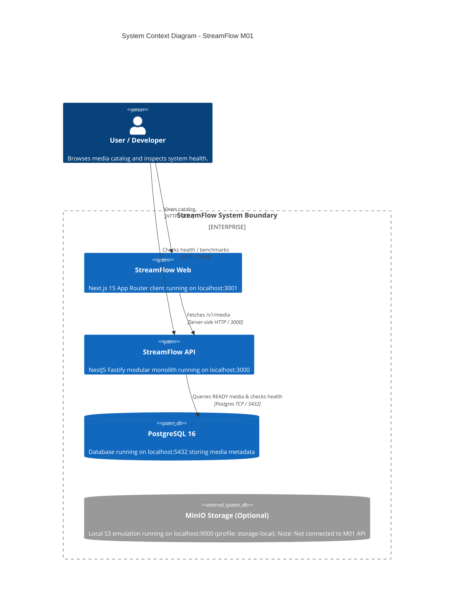

# StreamFlow — System Context (M01 Foundation)

## Architectural Notes (M01 Scope)
1. **Control Plane Only:** M01 delivers metadata catalog and health verification. Binary media upload, transcoding, and HLS playback will be introduced in M04–M05.
2. **Storage Separation:** Object storage (MinIO local or Cloudflare R2 cloud) is defined in infrastructure configuration, but M01 API does not proxy or serve binary media files.
3. **Future Components (Deferred):** Media Worker (FFmpeg), Event Relay, and Analytics Consumer directories exist as structural placeholders (`.gitkeep`) and will be implemented in subsequent milestones.
