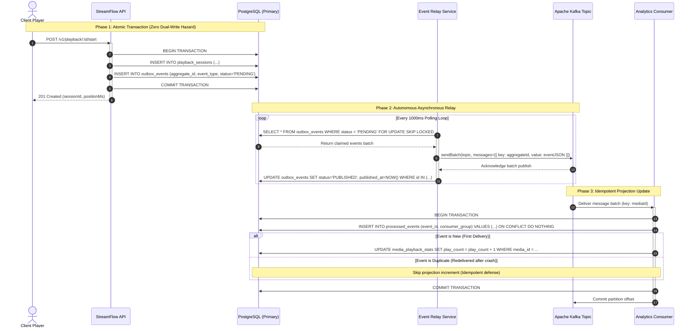

# StreamFlow — Transactional Outbox & Event-Driven Analytics Sequence

## Architectural Invariants
1. **Zero Dual-Write Risk:** Writing to `playback_sessions` and `outbox_events` within the same transaction ensures that an event is written if and only if the session is created.
2. **At-Least-Once Delivery to Kafka:** The Event Relay only marks an outbox record as `PUBLISHED` after Kafka explicitly acknowledges receipt.
3. **Idempotent Projections:** The Analytics Consumer guarantees that at-least-once message delivery produces exact-once business outcomes through inbox deduplication (`processed_events`).
