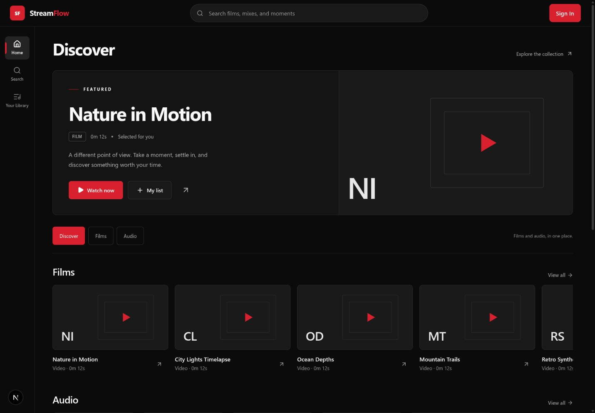

# StreamFlow simplified interface

The current style follows the user’s white–black–red direction: neutral black surfaces, white/gray typography, red primary actions, flat artwork, smaller corners, and reduced decorative copy.

The redesign adds Home, Search, Library, media Details, a persistent player, and an admin Studio. It keeps the existing API and auth boundaries.

[Mobile preview](streamflow-mobile.png)

The preview uses temporary local verification data. The application itself reads the real API; no fixture service or demo credentials are included in the product.

## Run locally

Configure `frontend/apps/web/.env.local` from `.env.example` in that directory, then run the API/backing services and `pnpm --filter @streamflow/web dev`. `NEXT_PUBLIC_API_BASE_URL` must be reachable from the browser. It is compiled into production client assets, so set it before building.

## Verified behavior

- Production routes build: `/`, `/search`, `/library`, `/playlists`, `/playlists/[id]`, `/profile`, `/media/[id]`, `/admin`.
- Desktop at 1440×1000 and mobile at 390×844.
- Search updates the URL and preserves keyboard focus after debounce.
- Media Details navigation and session-local Up next queue.
- Video HLS decoding and original audio playback using real local media fixtures.
- Mini-player remains mounted across route changes.
- Guest Library prompt; auth dialog closes with Escape and restores focus.
- Admin/non-admin/guest Studio rendering, file validation, concurrent favorites reconciliation, playback resume and monotonic progress retries covered by tests.
- Authenticated users can manage persistent playlists, history and profile details; administrators can manage media metadata and transcode jobs in Studio.

A browser attempt to log in as a local admin fixture was rejected by automatic approval review because privileged sign-in needs specific authorization. That action was not performed; Studio role behavior was checked through render/unit tests. Full backend integration tests retain the previously reported environment limitation (`initdb EPERM`).

## Design decisions

- Keep the existing dirty workspace and avoid commits while changes overlap prior work; this preserves that work but provides less isolation and no commit-level rollback for this feature yet.
- Use pure logic/render tests plus real browser checks instead of adding a DOM test dependency; modal interaction coverage lives in browser verification.
- Implement shared playback before connecting its consumer screens; this changes implementation order only.
- Add optional `sourceUrl` for original audio in the manifest; video continues to use HLS. This is an additive API field with regression tests.
- Catalog and Search use infinite scrolling with cursor pages of 20 items. See [infinite loading details](infinite-scroll.md). A recommendation service remains outside this UI change.
- Continue using the current auth-refresh architecture. Playback stays available if progress cannot be synced; the player shows a safe notice.

## Review fixes

The independent review found focus loss from remounting Search, stale Home state after Retry, racing favorites updates, delayed resume responses, omitted progress flushes at stop/next, and sync notices hidden behind native dialogs. These were addressed in one fix pass, with regression tests and browser verification for Search focus.

Client progress writes are serialized and reconcile the server's sequence before retrying, so a new playback session does not spend its first updates below an old session's sequence. No database schema change was needed.
