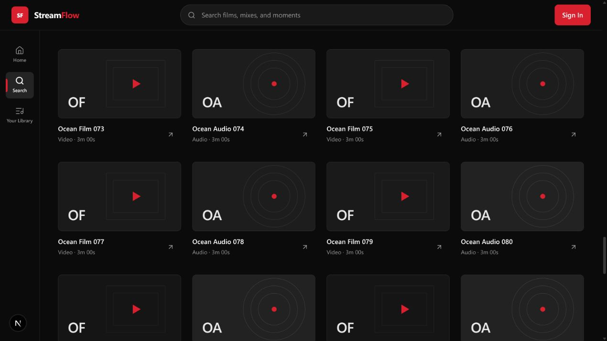

# Infinite media loading

Home, catalog browsing, and text search now load 20 items per page automatically when the list end is within 400px of the viewport. Type filters and query text are carried through each continuation request. The initial Home rails stay fixed; additional pages appear in the Keep exploring grid.

Loading preserves all existing cards. A failed request pauses automatic loading until Retry is selected. Browsers without IntersectionObserver receive a Load more fallback. A terminal page displays an end message and sends no further requests. The client prevents simultaneous requests, deduplicates IDs, cancels requests on unmount, ignores late responses, and rejects non-advancing or cyclic cursors.

Search now returns real nextCursor/hasMore values instead of being capped at its first page. Catalog and Search share the same (coalesce(published_at, created_at), id) descending order. Cursor timestamps are selected as PostgreSQL text and bound as strings so the postgres-js driver receives safe parameters and microsecond precision survives round trips. The catalog cache key is versioned to avoid reusing old pagination data. No dependencies or database migrations were added.

## Validation

- Browser: text search loaded 20 → 40 → 60 → 80 → 97 cards; 97 unique titles, terminal status rendered.
- Browser: simulated page failure retained 20 cards; Retry appended the next page to reach 40.
- Browser: switching to Videos reset to 20, continued to 49, and retained only video results.
- Browser: a new query with no matches removed old cards and showed a zero count.
- Browser: Home at 390px viewport width automatically appended 20 cards to Keep exploring.
- Web suite: 55 tests passed. Database pagination/SQL mapping: 5 tests passed. API unit tests: 16 passed. Contracts: 48 passed.
- Production build, full typecheck and Biome passed. Independent review findings for driver parameter encoding and timestamp precision were reproduced by failing tests and fixed.
- The catalog PostgreSQL integration suite was attempted; its setup still fails with spawnSync initdb EPERM in this environment (9 tests skipped). Actual database execution and query plans are not claimed as verified.

Browser checks used a temporary public local fixture, not production data. The fixture service is not part of the app.

